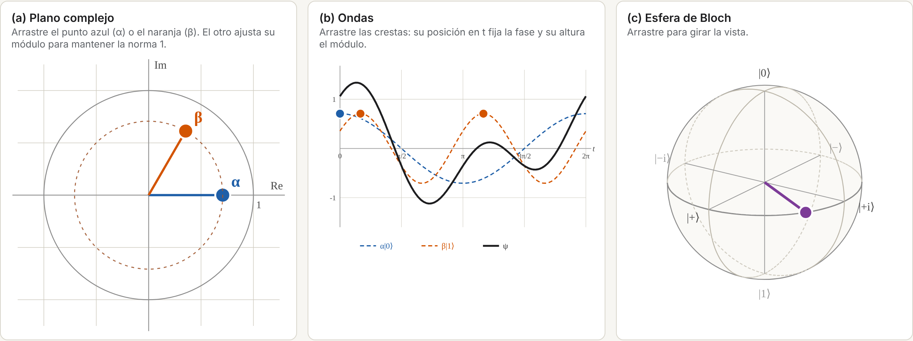

# Un qubit como superposición de ondas

Widget interactivo del **Taller 1, punto 1.2** de *Introducción a la Computación Cuántica*
(Universidad Nacional de Colombia, sede Medellín).

Los estados $|0\rangle \leftrightarrow \cos t$ y $|1\rangle \leftrightarrow \cos 2t$, con la
multiplicación $(Ae^{ix})\cdot\cos nt = A\cos(nt-x)$, forman el espacio de estados de un qubit.
El widget muestra un mismo estado $|\psi\rangle = \alpha|0\rangle + \beta|1\rangle$ en tres paneles
enlazados:

- **(a) Plano complejo**, donde se eligen $\alpha$ y $\beta$.
- **(b) Ondas** $\alpha|0\rangle$, $\beta|1\rangle$ y su superposición $\psi(t)$.
- **(c) Esfera de Bloch**, con el punto que corresponde a $|\psi\rangle$.



## Cómo usarlo

**En el navegador (sin instalar nada):** abrir la página publicada con GitHub Pages,
<https://mariasaurius.github.io/taller1-computacion-cuantica/>. La página también muestra un
resumen de las fórmulas para pasar de cada panel a los demás.

**En Python (Jupyter):** abrir `notebooks/punto_1_2_widget.ipynb`. Requiere

```bash
pip install numpy matplotlib ipympl ipywidgets
```

El notebook es la versión de referencia: define las fórmulas como funciones reutilizables
(para los puntos siguientes del taller) y verifica numéricamente que todas son consistentes.

## Estructura

| Archivo | Contenido |
|---|---|
| `index.html` | Página web: el widget en JavaScript y el resumen de fórmulas (KaTeX). |
| `notebooks/punto_1_2_widget.ipynb` | El mismo widget en Python con `ipywidgets` e `ipympl`, más las verificaciones. |
| `figuras/` | Captura de los tres paneles. |

Las dos versiones implementan las mismas fórmulas; la de JavaScript existe para que el widget
funcione en GitHub Pages, que solo sirve archivos estáticos y no puede ejecutar Python.
